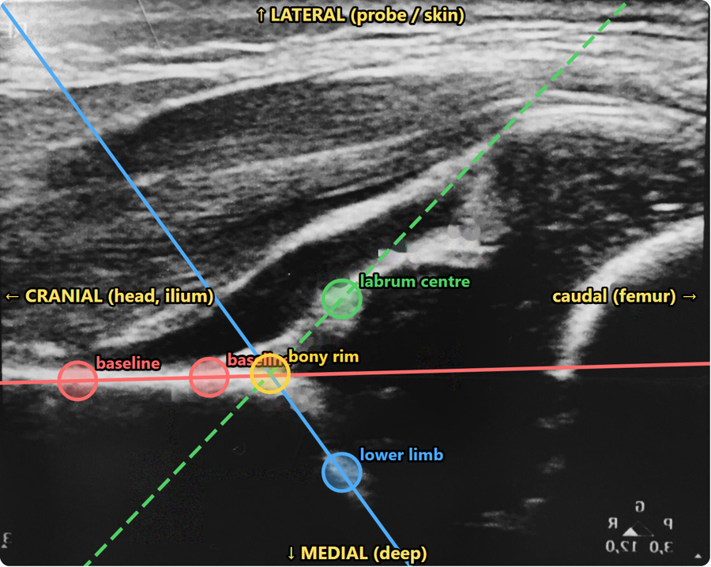

```{=html}
<div class="rv-wrap">
<section class="rv-hero">
  <div>
    <p class="rv-h1" role="heading" aria-level="1">Don't read about it. <i>Drag it.</i></p>
    <p class="lede">Every Radyssey lesson is a real image you can play with. Try it: slide the <span class="c-roof">bony rim</span> and watch the angle it makes with the <span class="c-base">baseline</span> decide the hip type.</p>
    <a class="rv-btn" href="posts/2026-10-26-graf-hip-ultrasound/">Start the Graf lesson <span class="arr">→</span></a>
    <p class="small">Free · works on your phone · no sign-up</p>
  </div>
  <div class="toy">
    <svg id="toy" viewBox="0 0 640 400" role="img" aria-label="Schematic infant hip. Drag the bony rim to change angle alpha and see the Graf type.">
      <defs><pattern id="sp" width="6" height="6" patternUnits="userSpaceOnUse"><circle cx="1" cy="1" r=".8" fill="var(--rv-ink-3)" opacity=".35"/></pattern></defs>
      <rect width="640" height="400" rx="14" fill="url(#sp)"/>
      <text x="16" y="24" font-family="Geist Mono" font-size="11" fill="var(--rv-ink-3)">LATERAL · SKIN</text>
      <text x="16" y="390" font-family="Geist Mono" font-size="11" fill="var(--rv-ink-3)">MEDIAL · DEEP</text>
      <path id="cartF" fill="var(--rv-cart)" opacity=".16"/>
      <circle id="head" r="72" fill="var(--rv-card)" stroke="var(--rv-ink-2)" stroke-width="2" stroke-dasharray="5 6"/>
      <text id="headT" font-family="Inter" font-size="13" fill="var(--rv-ink-3)" text-anchor="middle">femoral head</text>
      <path id="bone" fill="none" stroke="var(--rv-ink)" stroke-width="12" stroke-linecap="round" stroke-linejoin="round" opacity=".85"/>
      <line y1="200" y2="200" x1="0" x2="640" stroke="var(--rv-base)" stroke-width="2.5" stroke-dasharray="10 7"/>
      <line id="roofL" stroke="var(--rv-roof)" stroke-width="3"/>
      <line id="cartL" stroke="var(--rv-cart)" stroke-width="2.5"/>
      <path id="arc" fill="color-mix(in srgb, var(--rv-roof) 18%, transparent)" stroke="var(--rv-roof)" stroke-width="2"/>
      <text id="arcT" font-family="Newsreader" font-style="italic" font-size="22" fill="var(--rv-roof)">α</text>
      <g class="handle" id="handle"><circle id="hRing" class="ring" r="12" fill="none" stroke="var(--rv-roof)" stroke-width="2"/><circle id="hDot" r="11" fill="var(--rv-roof)" stroke="var(--rv-card)" stroke-width="3"/><circle id="hHit" r="28" fill="transparent"/></g>
    </svg>
    <div class="bar">
      <span class="read">α = <b id="aVal">60°</b></span>
      <span class="badge" id="badge">Type I · mature</span>
      <button class="reset" id="reset">↺ reset</button>
    </div>
    <p class="caption">A schematic hip, not a real scan. Types by α alone; the full lesson adds β and the baby's age.</p>
  </div>
</section>

<div class="rv-sec-head"><h2>Your route through radiology</h2><p>One real image per stop. Open a lesson, move the overlays, then test yourself.</p></div>
<div class="route" id="route">
  <svg class="line" id="pline" preserveAspectRatio="none" aria-hidden="true"><path id="pbg" fill="none" stroke="var(--rv-line)" stroke-width="3" stroke-dasharray="2 8" stroke-linecap="round"/><path id="pp" fill="none" stroke="var(--rv-brand)" stroke-width="3" stroke-linecap="round"/></svg>
  <div class="stop live"><span class="dot"></span><a class="stop-card" href="posts/2026-10-26-graf-hip-ultrasound/"><span class="k">Stop 01 · Ultrasound</span><h3>Graf hip ultrasound</h3><p>12 steps on one image. Drag the lines, then take the quiz.</p></a></div>
  <div class="stop"><span class="dot"></span><div class="stop-card"><span class="k">Stop 02 · Ultrasound</span><h3>ACR TI-RADS points <span class="lock" aria-hidden="true">🔒</span></h3><p>Coming soon</p></div></div>
  <div class="stop"><span class="dot"></span><div class="stop-card"><span class="k">Stop 03 · CT</span><h3>ASPECTS on CT <span class="lock" aria-hidden="true">🔒</span></h3><p>Coming soon</p></div></div>
  <div class="stop"><span class="dot"></span><div class="stop-card"><span class="k">Stop 04 · PET-CT</span><h3>Deauville scale <span class="lock" aria-hidden="true">🔒</span></h3><p>Coming soon</p></div></div>
  <div class="stop"><span class="dot"></span><div class="stop-card"><span class="k">Stop 05 · Doppler</span><h3>Carotid Doppler <span class="lock" aria-hidden="true">🔒</span></h3><p>Coming soon</p></div></div>
  <div class="stop"><span class="dot"></span><div class="stop-card"><span class="k">Stop 06 · Breast</span><h3>BI-RADS categories <span class="lock" aria-hidden="true">🔒</span></h3><p>Coming soon</p></div></div>
</div>
<h2 class="rv-section-label">All lessons</h2>
```

::: {#lessons}
:::

```{=html}
</div>
<script src="assets/home.js"></script>
```
