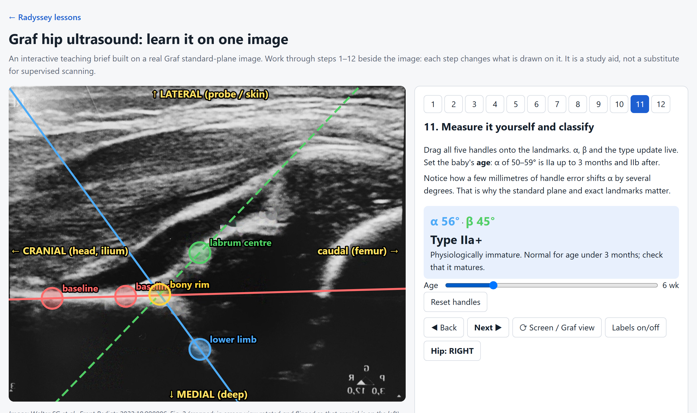

## What this lesson is

The **Graf method** is the standard way to assess an infant hip with ultrasound for developmental dysplasia of the hip (DDH). You take one coronal image of the hip in a standard plane, check that the image is usable, draw three lines, and read two angles: **α**, for the bony roof, and **β**, for the cartilage roof. Those two angles and the baby's age give the hip a type, from Ia (mature) to III/IV (dislocated).

The lesson is for **radiology residents**, and for anyone else who is learning to scan or report infant hips. It assumes basic ultrasound knowledge and nothing about Graf.

<a class="lesson-cta" href="../../lessons/graf-hip-ultrasound/index.html">Open the interactive lesson</a> <a class="lesson-cta lesson-cta-alt" href="../../lessons/graf-hip-ultrasound/index.html?step=12">Play with the angles</a>

[{.lesson-shot fig-alt="Screenshot of the Graf lesson, showing an infant hip ultrasound with the baseline, bony roof line and cartilage roof line drawn on it, next to the step panel showing α, β and the hip type."}](../../lessons/graf-hip-ultrasound/index.html)

## How to use the 12 steps

The lesson is one ultrasound image with a panel of 12 steps beside it. Each step changes what is drawn on the image.

1. **Steps 1–2, orientation.** Where the baby and the probe go, and which way is up on the screen. The **⟳ Screen / Graf view** button rotates the image between the scanner's view and the Graf standard view. **Hip: RIGHT / LEFT** shows how the left hip is displayed.
2. **Steps 3–6, anatomy.** Find the femoral head, the iliac wing, the bony roof and the lower limb of the os ilium, then the full eight-point checklist. Turn **Labels** off to test yourself.
3. **Step 7, usability.** The image may be measured only if the lower limb, a straight iliac wing and the labrum are all visible.
4. **Steps 8–11, measurement.** Draw the baseline, the bony roof line and the cartilage roof line. In step 11, drag the five handles yourself, set the baby's age, and watch α, β and the type update.
5. **Step 12, play with the angles.** The lines start on this image's own landmarks (α about 56°). Move the α slider and watch the bony roof steepen, the head drift out and up, and the type change from Ia to III/IV. The **Play with the angles** button jumps straight here.

Below the image are the classification table, an eight-question self-test and the references.

On a phone, open the lesson with the button above. The image stays at the top of the screen while you scroll through the steps. Use **Next ▶** or the step numbers to move between steps, and drag the handles with a finger.

<a class="lesson-cta" href="../../lessons/graf-hip-ultrasound/index.html">Open the interactive lesson</a>

## Image credit

::: {.credit}
Image: Walter SG et al., Front Pediatr 2022;10:990806, Fig. 2, CC BY 4.0. The image has been cropped and rotated, and the original labels were digitally removed. The coloured overlays and labels are added by the lesson: the landmark positions are hand-placed approximations, and the shallow-socket simulation in step 12 is a schematic drawn over the image, not a real dysplastic scan.
:::

## References

1. Graf R. Classification of hip joint dysplasia by means of sonography. Arch Orthop Trauma Surg. 1984;102(4):248–55. [doi:10.1007/BF00436138](https://doi.org/10.1007/BF00436138)
2. Ömeroğlu H. Use of ultrasonography in developmental dysplasia of the hip. J Child Orthop. 2014;8(2):105–13. [doi:10.1007/s11832-014-0561-8](https://doi.org/10.1007/s11832-014-0561-8) (Table 1: the angle thresholds; the standard plane)
3. Walter SG, et al. Four decades of developmental dysplastic hip screening according to Graf: what have we learned? Front Pediatr. 2022;10:990806. [doi:10.3389/fped.2022.990806](https://doi.org/10.3389/fped.2022.990806) (Fig. 2: the checklists and the image used here, CC BY 4.0)

Points marked "general knowledge" in the lesson are standard teaching that was not checked against these sources. This applies especially to the practical scanning tips in steps 1–2, and to telling type III from type IV by the position of the labrum. Management depends on local protocol and is not covered.
